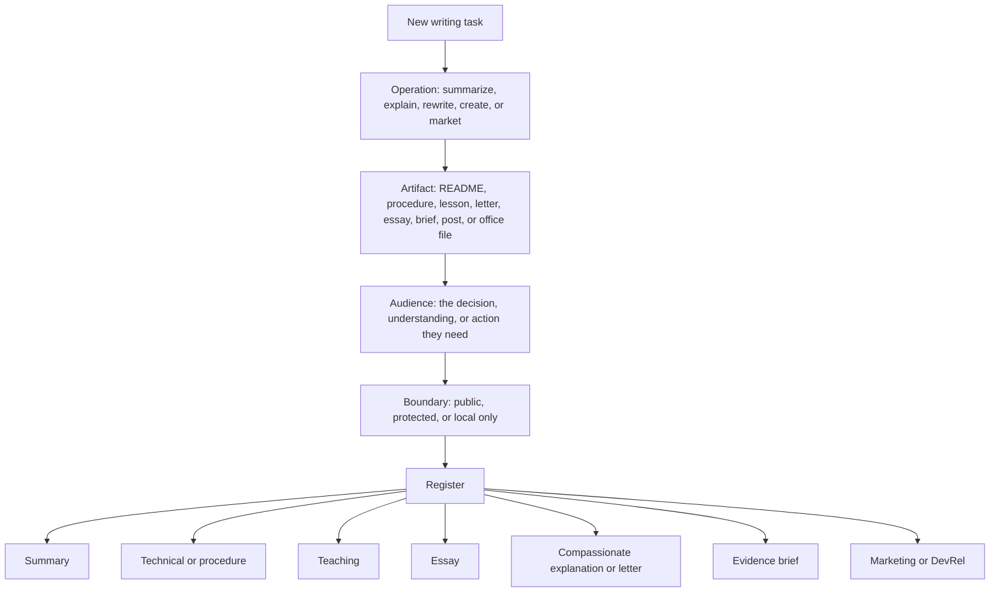

# Writing Postulate

A writing skill for people who use an LLM and want the prose to match the job.

Summaries, technical documentation, procedures, teaching pages, essays, letters, evidence briefs, and product or developer-relations copy do not want the same voice. Writing Postulate keeps the facts, the uncertainty, and the privacy boundary stable, then changes the structure, density, cadence, and warmth for the reader in front of the page.

If you searched for an LLM writing style, an AI writing skill, a Cursor skill for prose, a Claude skill for documentation, or a way to rewrite chatbot prose without sanding off the meaning, this repository is that contract.

It is a manual skill. It runs when you invoke `/writing-postulate`. It does not take over every chat.

## Who it is for

Use it when you already have material and a reader:

- You need a decision brief from a long source, and the uncertainty has to survive the summary.
- You are writing a README, a spec, or an explanation of a mechanism, and the terms have to stay exact.
- Someone has to follow a procedure, and each step needs a condition before the action.
- You are teaching a capable person who is new to the subject.
- You want public prose with care and cadence, still tied to what the source can show.
- The subject is sensitive, and the reader needs context rather than a script for their life.
- You are writing to one person and want a plain request with room for their reply.
- You are making a public claim and need the evidence status visible.
- You are drafting a launch note, a docs page, or a developer-relations post from something the product actually does.

## What changes, and what does not

| The register may change | The contract keeps |
| --- | --- |
| Sentence length and cadence | The facts and the numbers |
| Paragraph shape, tables, and steps | The uncertainty |
| How direct the address is | The privacy boundary |
| Warmth and first person | Source terms, commands, and quotations |
| A single action in a marketing piece | The refusal to invent proof |

A lyrical register is not the right one just because the subject is human. A compressed register is not the right one just because the source is technical. [GUIDE.md](GUIDE.md) shows how the route is chosen. [examples/by-purpose.md](examples/by-purpose.md) writes one invented trail-planner packet ten ways, so you can see the difference on the page.

## How a task is routed



The order is the point. Audience and privacy come before tone. A protected record can yield a method. It does not yield its contents. Local-only material stays unopened and undescribed.

## Registers

| Register | Use it when | The page should |
| --- | --- | --- |
| Summary or brief | Someone must decide | Lead with the decision, keep the evidence and the doubt |
| Technical explanation | The reader must see how something works | Start with the mechanism and name the limit |
| Procedure | The reader must do the thing | Put the condition before the command, one action per step |
| Teaching | The reader is new and capable | Orient, give one familiar example, then unfold the mechanism |
| Sophisticated prose | The reader is following a public argument | Let cadence carry a trade-off, and stop on an observation |
| Compassionate explanation | The subject is sensitive | Stay steady and relational, with no diagnosis and no life instructions |
| Personal letter | One person is the reader | Ask plainly and leave room for what they know |
| Evidence brief | A claim has to stay inspectable | Separate claim, source, status, and boundary |
| Marketing or DevRel | The task is attention, launch, search, or conversion | Use supplied customer language, shipped proof, and one action |

## Where the approaches are explained

Two different things are easy to mix up.

**Registers** are the writing jobs. The table above is the short list. [GUIDE.md](GUIDE.md) says how to choose one. [examples/by-purpose.md](examples/by-purpose.md) is the page that shows them: one trail-planner packet written as a summary, a README, a procedure, a lesson, an essay, a compassionate explanation, a letter, an evidence brief, and a marketing note. Each section ends with a line on what changed.

**Methods** are the approaches under those jobs: concrete prose, plain mechanism, a pass against chatbot filler, purpose-matched summary, documentation discipline, office-file structure, and source-first marketing. Those are explained in sentences in [references/sources.md](references/sources.md), including what each approach keeps and what it refuses.

The routing rules for summaries, documentation, office files, and marketing are in [references/routing.md](references/routing.md). The contract the model follows is [SKILL.md](SKILL.md).

## Install

The skill folder has to contain `SKILL.md` and the `references/` and `examples/` directories beside it. The contract reads those files by relative path. Copying `SKILL.md` alone leaves the routes and examples unreachable.

Link or copy this repository:

```bash
ln -s /path/to/writing-postulate ~/.claude/skills/writing-postulate
ln -s /path/to/writing-postulate ~/.cursor/skills/writing-postulate
```

Claude Code reads `~/.claude/skills`. Cursor reads `~/.cursor/skills`. The two folders are separate, so a skill installed for one does not appear in the other. A project-only copy can live at `.claude/skills/writing-postulate` inside that project.

The skill is manual. In Claude Code, start a session in a normal directory, then run:

```text
/writing-postulate
```

If the command is missing, run `/reload-skills` or start a new session. Claude on the web does not read `~/.claude/skills`. For that product, add the same folder as a custom skill in the Claude skill settings.

Start a chat with:

```text
/writing-postulate
```

Then name the file or paste the source, name the reader, and name the job. If the audience would change the result, the skill asks one question before it drafts.

Example invocations:

```text
/writing-postulate
Summarize this incident note for the person who must decide whether to pause the rollout.
Keep the uncertainty. Do not add a motivational close.
```

```text
/writing-postulate
Rewrite the README section on export so a new maintainer can see why a pitch
is detected and a string name is not. Leave the commands and paths as they are.
```

```text
/writing-postulate
Draft a release note for the route-record panel. Use only the behavior in
this changelog. One action at the end. No scarcity and no invented quotes.
```

## A small example

The same public facts:

> A route planner has 1,240 verified trail records. It can recommend a route when the source is recent and the season is complete. It cannot confirm today's snow, a closure, or a person's fitness.

A decision summary says what to do with that limit. A README names the fields and the rule. A lesson starts with a card in a hut log, then states the same rule. A letter tells one person what the writer will not pretend to know. None of those versions adds snow, a closure, or a fitness score.

The full set, with a line on why each one differs, is in [examples/by-purpose.md](examples/by-purpose.md). Checks for those routes are in [tests/scenarios.md](tests/scenarios.md).

## What good use looks like

- The first paragraph does the job: a decision, a mechanism, an orientation, or a request.
- Unfamiliar terms are defined once.
- Evidence and interpretation stay apart.
- Commands, identifiers, numbers, citations, and quotations survive a rewrite unless you ask to change them.
- Headings, tables, notes, and tracked changes in a DOCX, PDF, PPTX, or Markdown file survive unless you ask to change the structure.
- A marketing draft can point to something a person can now do. It does not invent a customer, a crowd, or a deadline.

## What it will not do

- Imitate a named author or speaker.
- Diagnose a reader, score them, or give unsolicited advice about their life.
- Reveal or infer a protected record.
- Manufacture urgency, scarcity, consensus, fear, or quotations.
- Optimize sentences to evade an AI detector. The aim is accurate prose for a reader, not a score.

The methods it keeps, and the ones it refuses, are explained in [references/sources.md](references/sources.md).

## Repository map

| File | Read it for |
| --- | --- |
| [SKILL.md](SKILL.md) | The contract the model follows |
| [GUIDE.md](GUIDE.md) | How to choose a register before you draft |
| [examples/by-purpose.md](examples/by-purpose.md) | One source written for ten purposes |
| [references/routing.md](references/routing.md) | Summaries, documentation, office files, and marketing gates |
| [references/sources.md](references/sources.md) | Each borrowed approach, in sentences, plus what it refuses |
| [tests/scenarios.md](tests/scenarios.md) | Pass conditions for each route |
| [LICENSE](LICENSE) | MIT |

## License

[MIT](LICENSE). Use it, change it, and keep the copyright notice with the copy.
